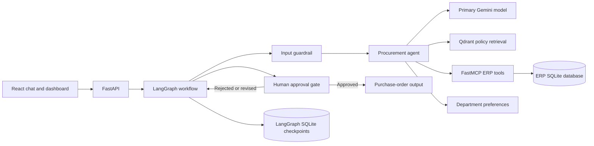

# AI-Powered Procurement and Vendor Assistant

An AI-assisted procurement workspace for departments to request purchases, find approved vendors, draft purchase orders, check policy compliance, and route high-risk or high-value requests to human approval.

The project combines a FastAPI backend, a LangGraph workflow, RAG-backed policy guidance, FastMCP ERP tools, local departmental preferences, Qdrant, and a React/Vite management interface.

## What It Does

- Accepts procurement requests through a chat interface.
- Retrieves relevant procurement policies and vendor requirements with citations.
- Uses ERP/MCP tools to look up vendors, products, contracts, and approval state.
- Generates structured procurement outputs such as purchase-order drafts.
- Applies input and output guardrails.
- Requires human approval when the configured value threshold or policy rules are met.
- Exposes a graph-state view and JSON debug data for inspecting the agent workflow.
- Stores LangGraph checkpoints and ERP data locally.

## Architecture



## Repository Layout

```text
backend/
  app/
    api/                 FastAPI route modules
    graph/               LangGraph state and workflow nodes
    llm/                 LLM provider/router
    mcp/                 ERP MCP server and client
    memory/              Department preference storage
    prompts/             CPO/procurement prompt definitions
    rag/                 Policy ingestion and retrieval
    schemas/             API and purchase-order models
  data/
    policies/            Procurement policy source documents
    seed_erp.py          ERP seed data and setup script
  tests/                 Guardrail, HITL, MCP, RAG, and schema tests
frontend/
  src/
    components/          Chat, approval, and graph-inspector UI
    hooks/               Chat state and API integration
    services/            Backend API client
docker-compose.yml         Qdrant vector database
.env.example               Environment variable reference
```

## Prerequisites

- Python 3.11+
- Node.js 18+ and npm
- Docker with Docker Compose
- A Google AI Studio API key
- Optional: a LangSmith API key for trace collection

## Quick Start

### 1. Configure the environment

Copy the example configuration and replace placeholder secrets:

```bash
cp .env.example .env
```

At minimum, set `GOOGLE_API_KEY`. Keep `.env` out of source control.

### 2. Start Qdrant

```bash
docker compose up -d qdrant
```

Qdrant exposes:

- HTTP API: `http://localhost:6333`
- gRPC: `localhost:6334`

Check its status with:

```bash
docker compose ps
```

### 3. Set up the backend

```bash
# From the repository root
python -m venv .venv
# Windows PowerShell
.\.venv\Scripts\Activate.ps1
# macOS/Linux
source .venv/bin/activate
python -m pip install --upgrade pip
pip install -r backend/requirements.txt
```

Seed the ERP and index the Markdown policies. Make sure `backend/data/policies/` contains non-empty policy documents before indexing:

```bash
cd backend
python data/seed_erp.py
python -m app.rag.ingest
cd ..
```

The ERP seed script adds sample vendors, catalog items, and department budgets.
It only inserts missing records and does not reset existing database data.
The SQLite files are local, Git-ignored runtime data: rerun the seed script to
recreate the sample ERP records, and let LangGraph initialize the checkpoint
schema when the graph is compiled. Checkpoint files can contain conversation
state and should remain local.

Start the API from the repository root:

```bash
# Windows PowerShell
.\.venv\Scripts\python.exe -m uvicorn app.main:app --app-dir backend --reload --host 127.0.0.1 --port 8000
# macOS/Linux, with the virtual environment activated
python -m uvicorn app.main:app --app-dir backend --reload --host 127.0.0.1 --port 8000
```

API documentation should then be available at:

- Swagger UI: `http://localhost:8000/docs`
- ReDoc: `http://localhost:8000/redoc`

Keep the API running in that terminal. In a second terminal, start the frontend:

### 4. Set up the frontend

```bash
cd frontend
npm install
npm run dev
```

Open the Vite URL printed in the terminal, normally `http://localhost:5173`.

## Configuration

| Variable                       | Purpose                                                                                                      | Default/example                                |
| ------------------------------ | ------------------------------------------------------------------------------------------------------------ | ---------------------------------------------- |
| `GOOGLE_API_KEY`               | Google Gemini API credential                                                                                 | Required                                       |
| `PRIMARY_MODEL`                | Primary chat model                                                                                           | `gemini-3.8-flash`                             |
| `FALLBACK_MODEL`               | Fallback chat model                                                                                          | `gemini-3.5-flash-lite`                        |
| `EMBEDDING_MODEL`              | RAG embedding model                                                                                          | `models/gemini-embedding-001`                  |
| `LANGSMITH_API_KEY`            | LangSmith tracing credential                                                                                 | Optional                                       |
| `LANGSMITH_TRACING`            | Enables LangSmith tracing                                                                                    | `true`                                         |
| `LANGSMITH_PROJECT`            | LangSmith project name                                                                                       | `ai-powered-procurement`                       |
| `LANGSMITH_ENDPOINT`           | LangSmith API endpoint                                                                                        | `https://api.smith.langchain.com`              |
| `FASTAPI_HOST`                 | API bind host                                                                                                | `0.0.0.0`                                      |
| `FASTAPI_PORT`                 | API bind port                                                                                                | `8000`                                         |
| `CORS_ORIGINS`                 | Comma-separated allowed frontend origins                                                                     | `http://localhost:5173`                        |
| `VITE_API_BASE_URL`            | Optional frontend API origin; when unset, requests use the same origin and Vite proxies to the local backend | Unset                                          |
| `LANGGRAPH_CHECKPOINT_DB_PATH` | Workflow checkpoint SQLite file                                                                              | `./backend/data/langgraph_checkpoints.sqlite`  |
| `RECURSION_LIMIT`              | Maximum LangGraph recursion depth                                                                            | `8`                                            |
| `ERP_DATABASE_PATH`            | ERP SQLite file path                                                                                         | `./backend/data/erp_database.sqlite`           |
| `ERP_DATABASE_URL`             | SQLAlchemy-style ERP database URL                                                                            | `sqlite:///./backend/data/erp_database.sqlite` |
| `QDRANT_URL`                   | Qdrant HTTP endpoint                                                                                         | `http://localhost:6333`                        |
| `QDRANT_API_KEY`               | Optional Qdrant credential                                                                                   | Empty for local use                            |

### LangSmith tracing

Set `LANGSMITH_API_KEY` and `LANGSMITH_TRACING=true` to collect traces. The
application automatically adds thread IDs, workflow tags, run names, and
project metadata to chat and approval runs. `LANGCHAIN_*` names remain
supported for backward compatibility.
| `QDRANT_COLLECTION`            | Policy vector collection                                                                                     | `procurement_policies`                         |
| `HITL_APPROVAL_THRESHOLD`      | Amount that triggers human approval                                                                          | `500`                                          |
| `RAG_TOP_K`                    | Number of policy chunks to retrieve                                                                          | `5`                                            |
| `RAG_MIN_CONFIDENCE`           | Minimum confidence for usable RAG evidence                                                                   | `0.72`                                         |

Relative database and policy paths are resolved from the backend working directory or repository root according to the application's path configuration.

## Workflow and Human Approval

The LangGraph workflow is expected to move through these stages:

1. **Input guardrail**: validate or reject unsafe, incomplete, or out-of-domain requests.
2. **Procurement agent**: interpret the request and retrieve needed context.
3. **Policy RAG**: find and cite relevant procurement rules.
4. **ERP/MCP tools**: inspect vendors, products, contracts, and existing records.
5. **Output guardrail**: validate the generated response and structured purchase order.
6. **Human approval**: pause for approval when required.
7. **Final response**: return a cited answer or approved purchase-order draft.

Approval is part of the workflow state, not a separate side effect. Resume or reject operations must preserve the original thread/checkpoint ID.

## API Surface

The backend modules are organized around these capabilities:

- `chat.py`: submit procurement conversations; workflow requests time out after 120 seconds rather than hanging indefinitely.
- `approvals.py`: list pending approvals and approve, reject, or revise requests.
- `graph_state.py`: inspect workflow state and graph metadata.

Exact route names and payloads are available in Swagger UI once the FastAPI server is running.

## Testing

Run the backend test suite from the `backend` directory:

```bash
cd backend
pytest -q
```

The test layout covers:

- `test_guardrails.py`: input and output safety checks
- `test_hitl_workflow.py`: approval gates and workflow resumption
- `test_mcp_tools.py`: ERP tool integration
- `test_memory.py`: departmental preference behavior
- `test_rag_citations.py`: policy retrieval and citations
- `test_structured_outputs.py`: API and purchase-order schemas

Stop the local Qdrant container with:

```bash
docker compose down
```

To remove the named Qdrant volume as well:

```bash
docker compose down -v
```

## Security and Production Notes

- Never commit `.env`, API keys, certificates, or database snapshots.
- Treat generated procurement and purchase-order content as advisory until a human approves it.
- Restrict approval endpoints and ERP mutations with authentication and authorization before deployment.
- Add TLS, secret management, and persistent backups for production use.
- Review citation grounding and guardrail behavior against the organization's procurement policies.
